<!-- ░▒▓ PRABHDEEP.EXE ▓▒░  —  all visuals live in /assets as animated SVGs -->


 

 


  


<a href="https://github.com/Prabhdeep1701/WRAITH"></a>
<a href="https://github.com/Prabhdeep1701/RetroWraith"></a>
<a href="https://github.com/Prabhdeep1701/Talon"></a>
<a href="https://github.com/Prabhdeep1701/RetroCloud"></a>
<a href="https://secure-quiz-platform2.vercel.app"></a>
<a href="https://github.com/Prabhdeep1701?tab=repositories"></a>

 


 

 

 

  

 

 


 

